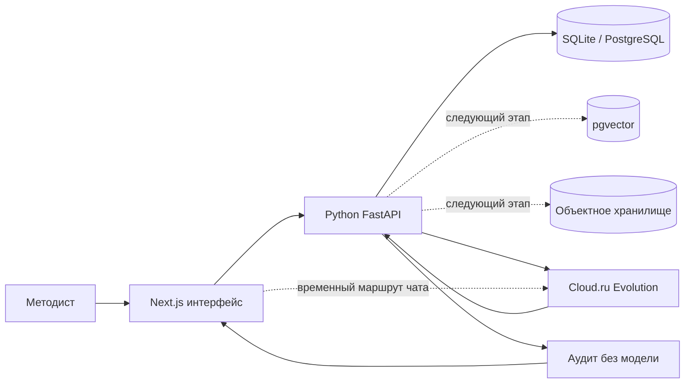

# Студия образовательных программ

Веб-агент для методиста. Слева запрос и файлы, справа документ программы. Ноутбук `notebooks/solution.ipynb` повторяет тот же порядок шагов и читает материалы кейса.

## Запуск через Docker

```bash
cd edu-course-agent
cp .env.example .env
docker compose up --build
```

Откройте студию на [http://localhost:3000](http://localhost:3000), FastAPI — на [http://localhost:8000/docs](http://localhost:8000/docs). Compose поднимает Next.js, FastAPI и PostgreSQL, ждёт готовности БД и автоматически применяет миграции Alembic.

Для живой генерации заполните `CLOUDRU_API_KEY` в `.env`. Без ключа доступны офлайн-пример, загрузка файлов, аудит и выгрузки. Для остановки: `docker compose down`. Данные PostgreSQL остаются в volume `postgres-data`; удалить их можно только явно командой `docker compose down -v`.

## Локальный запуск

Модель курса — [Foundation Models в Cloud.ru Evolution](https://cloud.ru/docs/foundation-models/ug/topics/api-ref). В `.env` нужен API-ключ из личного кабинета. Без ключа работают пример, проверка часов, приём файлов и выгрузки. Для генерации используется `CLOUDRU_MODEL_WRITER`, а при его отсутствии — `CLOUDRU_MODEL`.

```
CLOUDRU_API_KEY=...
CLOUDRU_BASE_URL=https://foundation-models.api.cloud.ru/v1
CLOUDRU_MODEL=ai-sage/GigaChat3-10B-A1.8B
CLOUDRU_MODEL_WRITER=GigaChat/GigaChat-3-Pro
```

Агент сначала собирает каркас: компетенции и учебный план, сумма часов равна объёму. Кнопка «Утвердить каркас» открывает тесты, задания и лекции. Источники агент берёт только из текста методиста и не выдумывает приказы и профстандарты.

Подготовьте оба контура:

```bash
cp .env.example .env
npm ci
python -m pip install -r backend/requirements.txt
npm run backend:migrate
```

Запустите FastAPI:

```bash
npm run backend
```

В другом терминале запустите интерфейс:

```bash
npm run dev
```

Студия открывается на [http://localhost:3000](http://localhost:3000), Swagger — на [http://localhost:8000/docs](http://localhost:8000/docs). Кнопка «Пример 24 ч» показывает заполненную студию без модели; прямая ссылка — `http://localhost:3000/?sample=1`.

Чтобы Next.js направлял чат и сохранение версий в Python, в `.env` должны быть:

```env
PYTHON_AGENT_URL=http://127.0.0.1:8000
NEXT_PUBLIC_PYTHON_API_URL=http://127.0.0.1:8000
DATABASE_URL=sqlite:///backend/data/studio.db
```

Если порт 3000 занят, запустите `npx next dev -p 3010` и откройте `http://localhost:3010/?sample=1`.

## Контракт API

Схема собирается из кода и открывается в Swagger UI: [http://localhost:8000/docs](http://localhost:8000/docs). Машиночитаемый документ — [http://localhost:8000/openapi.json](http://localhost:8000/openapi.json).

| Метод и путь | Что проверяет или делает |
| --- | --- |
| `GET /health` | Процесс отвечает. |
| `POST /api/audit` | Без модели: шаблон, сумма часов, шаг 0,5, ключ вопроса, дословный результат обучения, тест и практическое задание на каждый результат, наличие источника. |
| `POST /api/regulatory/check` | Утверждение имеет ссылку и реквизиты. Документ не объявляется действующим. |
| `GET /api/regulatory/policy` | Правила, по которым нельзя выдумывать приказы и профстандарты. |
| `POST /api/chat/turn` | Один ход диалога. Неподтверждённые часы и реквизиты отбрасывает код. |
| `POST /api/run` | Прогон запроса. Поле `report.audit` использует те же правила, что `POST /api/audit`. |
| `PUT /api/courses/{id}` | Новая версия курса. Часы вне шага 0,5 и вопрос без ключа не сохраняются. |
| `GET /api/courses/{id}` | Последняя версия, сообщения и источники. |

## Архитектура

Проект начинался как Next.js-прототип. Интерфейс остаётся на React, а схемы курса, правила, хранение, `/api/run` и оркестратор перенесены в Python. Next.js-маршрут чата теперь служит адаптером между Python-событиями и протоколом AI SDK; прежний TypeScript-оркестратор временно сохранён как fallback до живого прогона пяти кейсов.

Переходная архитектура:

1. **Next.js / React** — интерфейс методиста, локальный офлайн-пример и тонкий слой совместимости с потоковым чатом.
2. **Python / FastAPI** — основной backend для оркестрации Cloud.ru, обработки документов, аудита курса и контроля нормативных источников.
3. **Cloud.ru Evolution** — генерация структурированных изменений курса после выдачи доступа.
4. **SQLite / PostgreSQL** — реализованное хранение курсов, версий, сообщений и источников через SQLAlchemy. Локально используется SQLite, Docker Compose поднимает PostgreSQL.
5. **pgvector** — следующий этап для поиска по подтверждённым материалам; сейчас не подключён.
6. **Объектное хранилище** — следующий этап для исходных DOCX/PDF и сформированных DOCX/PPTX.
7. **Детерминированные проверки** — часы, связи, два оценочных средства и источники проверяются кодом, а не моделью.
8. **Python-ноутбук** `notebooks/solution.ipynb` — пошаговый сценарий, проверка материалов, аудит API и опциональный живой прогон.



Курсы и история сообщений сохраняются через SQLAlchemy: локально в SQLite, в развёрнутом окружении — в PostgreSQL через `DATABASE_URL`. `localStorage` остаётся безопасным fallback и источником миграции старой сессии. pgvector и объектное хранилище остаются следующим инфраструктурным этапом. До подтверждения одинакового поведения на пяти запросах прежний TypeScript-маршрут не удаляется.

Подробно компоненты, поток данных и границы готовности описаны в [`docs/architecture.md`](docs/architecture.md).

## Нормативные документы

Студия должна работать с документами Минпросвещения России, Минобрнауки России, Минтруда России, Федеральным законом № 273-ФЗ, профстандартами и шаблонами АЦР. Правила:

- документ берётся из файла методиста или по проверяемой ссылке;
- название, номер, дата приказа и код трудовой функции не придумываются;
- источник сохраняется в `brief.references` и попадает в отчёт и DOCX;
- неподтверждённые реквизиты помечаются и не считаются проверенными;
- применимость документа и финальную редакцию подтверждает методист.

Python API `/api/regulatory/check` проверяет наличие источника и реквизитов, но намеренно не объявляет документ действующим автоматически.

Проверки часов, брифа, аудита курса, экспортов и схем инструментов:

```bash
npm test
```

Локальные проверки: `npm test` (46 тестов), `python -m pytest backend/tests -q` (14 тестов) и `npm run build`. Живой прогон без браузера:

```bash
npm run dev
# в другом терминале
node scripts/run-cases.mjs 4
# или POST /api/run с { "request": "...", "answers": "...", "references": "..." }
```

Материалы кейса лежат в `materials/`. В репозитории сохранены исходные `.docx` и их текстовые извлечения `.txt`.

- `program-general-24h` — интенсив, 24 часа
- `program-qualification-248h` — стажировка, 248 часов
- `open-cases` — пять открытых запросов и чек-листы

Ноутбук запускается из папки `notebooks`. Для ячеек аудита должен работать FastAPI на порту 8000:

```bash
cd notebooks
jupyter notebook solution.ipynb
```

## Что входит в решение

Текущий статус реализации. Формальные проверки покрыты тестами; качество генерации полного комплекта ещё нужно подтвердить прогоном пяти запросов через Cloud.ru.

| Что входит в решение | Приоритет | Статус |
| --- | --- | --- |
| Поддержка обоих шаблонов АЦР, любого ИТ-направления и объёма 16–500 часов | Обязательно | Частично. Шаблоны «общеразвивающая» и «повышение квалификации» есть в данных и на экране. Направление задаётся текстом запроса. На пяти запросах с моделью ещё не проверяли. |
| Прием запроса и референсов в .docx, .pdf и тексте, уточняющие вопросы | Обязательно | Частично. Есть свободный текст, форма шаблона, кнопки «Файл» и «Ссылка». Загруженные материалы записываются в референсы курса. Для «примерно месяц» агент обязан спросить точные часы; это защищено кодом и unit-тестом, живой прогон ещё нужен. |
| Карта компетенций, в которой каждая компетенция связана со знаниями, умениями, навыками, темами, вопросами и заданиями | Обязательно | Частично. Поля и связи есть. В примере каждый результат обучения связан с тестовым вопросом и практическим заданием; для новых курсов это проверяет вкладка «Проверка». Качество связей модели ещё не проверено на пяти запросах. |
| Учебный и учебно-тематический план с часами по видам работы и автоматической проверкой сумм | Обязательно | Готово в коде и в Swagger. Шаг 0,5: сохраняются 0,5 и 1,5. Прямое сохранение значения вне шага отклоняется, правка агента округляется до ближайшего шага. Сумма модулей дотягивается до объёма минус аттестация. На модели не проверяли. |
| Тестовые вопросы с ключами и привязкой к результатам обучения | Обязательно | Готово в схеме, примере, `POST /api/audit` и отчёте `POST /api/run`. Ключ обязателен, результат обучения должен дословно быть в модуле, задание без такой связи тоже не проходит. Новый комплект на модели ещё не проверен. |
| Задания для семинаров с критериями оценки | Обязательно | Готово в схеме и примере: у задания есть критерии, компетенция и результат обучения. Новый комплект агент пишет после утверждения каркаса. |
| Планы лекций и слайды в .pptx хотя бы для одного модуля | Обязательно | Готово в офлайн-примере. Кнопки HTML и PPTX выгружают материалы лекций; бинарная сборка покрыта тестом. |
| Выгрузка программы в .docx по шаблону АЦР | Обязательно | Частично. Кнопка DOCX собирает структуру по двум примерам АЦР. Точное визуальное совпадение с официальным бланком ещё не подтверждено. |
| Отчет автопроверки по часам, покрытию, источникам и полноте разделов | Желательно | Частично. Вкладка «Проверка» и JSON-отчёт проверяют каркас, комплект, два оценочных средства на результат и наличие источников. Подлинность нормативных источников остаётся ручной проверкой. |
| Точечная доработка отдельной части без пересборки всего комплекта | Желательно | Частично. Инструмент правки одной секции есть. Правка каркаса снова требует утверждения. Без модели в чате это не прогнать. |
| Выгрузка тестов в формат LMS (GIFT, Moodle XML или CSV) | Желательно | Нет. |
| Актуализация старой программы с поиском устаревших тем и инструментов | Сверх плана | Нет. |
| Адаптация готовой программы под другую аудиторию или другой объем часов | Сверх плана | Нет отдельного сценария. Аудиторию и объём можно поменять в запросе, комплект сам не пересобирается. |

## Текущие ограничения

- Для запроса «примерно месяц» защита от выдуманного объёма покрыта тестом: агент должен запросить точные часы и тип программы. Поведение ещё нужно подтвердить в общем прогоне пяти кейсов.
- Есть `POST /api/run` (текст → JSON) и `scripts/run-cases.mjs`. Комплект на все модули дописывается несколькими раундами; полноту ещё нужно подтвердить живым прогоном пяти запросов.
- DOCX строится по структуре примеров, но точное визуальное совпадение с официальным бланком АЦР ещё не подтверждено.
- В примере каждый результат закрыт тестом и практическим заданием. Тот же отчёт отдают вкладка «Проверка», `POST /api/audit` и `report.audit` у `POST /api/run`. Качество нового комплекта на модели ещё нужно прогнать.
- LMS-экспорт, pgvector и объектное хранилище пока не реализованы.

## Продуктовый чекпоинт 15 октября

Мягкий отсев. Смотрят бриф и прототип: понят ли методист, ценность каркаса, план по пяти запросам.

Слайды: `checkpoint-15-oct.html`. Прототип — студия с офлайн-примером «Пример 24 ч» и подключаемой генерацией Cloud.ru. Артефакт сдаётся в систему оператора, не коммитом в git.

### Критерии финала (Магас, до 15 баллов)

| Критерий | Что готовить |
| --- | --- |
| Продуктовая ценность | Студия переносит проверку часов и связей на этап каркаса. Человек остаётся на «Утвердить каркас», источниках из файлов, приказах и подписи. Эффект по времени измеряется на пилоте. |
| Реалистичность внедрения | Студия на виртуалке, модели Cloud.ru Evolution. Шаги агента → навыки GigaCowork после хакатона. |
| Питч и ответы | Показываем офлайн-пример, аудит и выгрузки DOCX/PPTX. Честно обозначаем: точное совпадение DOCX с официальным бланком не подтверждено, LMS-экспорта нет, полный комплект модели ещё не прогнан на пяти кейсах. |

### Запрос 4 (колледж)

Промпт больше не превращает «примерно месяц» в 72 часа сам. Агент сначала спрашивает тип, часы, уровень, форму и аттестацию. Объём и шаблон принимаются только из ответа методиста.

## Что проверить руками

Без ключа Cloud.ru:

1. Открыть студию и нажать «Пример 24 ч». Сверху шаги: Запрос, Каркас, Комплект.
2. На вкладке «Обзор» шаблон — общеразвивающая программа, в таблице часов итог 24 из 24.
3. На «Компетенциях» у узлов есть знания, умения и навыки.
4. На «Плане» у модулей часы разложены на лекции, практику, лабораторные и самостоятельную работу.
5. На «Тестах» у вопросов видны ключи и результаты обучения.
6. На «Семинарах» у заданий есть критерии.
7. На «Лекциях» открываются слайды. Справа HTML и PPTX скачивают слайды, DOCX — программу, «Отчёт» — JSON аудита.
8. Слева кнопка «Файл»: приложить исходный `.docx` из пакета организаторов. В блоке референса появляется текст, а источник — в обзоре программы.
9. Справа «Утвердить каркас» сменяет кнопку на «Снять утверждение». Слева вместо «Дособрать каркас» появляется «Собрать комплект». «Снять утверждение» возвращает к каркасу.
10. «Новый курс»: кнопка «Утвердить каркас» не нажимается.
11. В ноутбуке `notebooks/solution.ipynb` проверка часов примера проходит, расхождение строки на 248 часах помечено.

После ключа Cloud.ru:

1. «Новый курс», свободный текст: неполный запрос из `materials/open-cases` про кибербезопасность. Агент должен спросить тип программы, точные часы, уровень, форму и аттестацию, не подставляя 72 часа сам.
2. Форма «Шаблон»: повышение квалификации, 72 часа, аудитория и цель. «Собрать по шаблону» должен нарисовать каркас, часы на экране сходятся, тестов ещё нет.
3. После «Утвердить каркас» кнопка «Собрать комплект» дописывает тесты с ключами, семинары с критериями и лекции.
4. Попросить поправить один модуль. Остальные модули остаются на месте, утверждение каркаса сбрасывается.

## Holix

Чат студии ходит в Cloud.ru Evolution. Holix подключается к репозиторию как помощник: при запуске из этой папки он читает `.holix/HOLIX.md` и навык `.holix/skills/edu-methodist`. Проверка часов и правка секции живут в самой студии.
