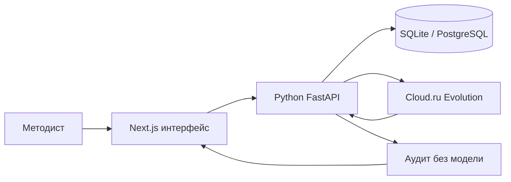

# Студия образовательных программ

Веб-агент для методиста АЦР: запрос и файлы слева, программа справа. Собирает оба шаблона (общеразвивающая и повышение квалификации), любой ИТ-запрос и объём 16–500 часов. Часы и коды трудовых функций берёт только из слов или файла методиста.

## Запуск

Один рабочий путь — Docker. Наружу только порт 8000.

```bash
cp .env.example .env
docker compose up --build
```

Студия: [http://localhost:8000](http://localhost:8000). FastAPI: [http://localhost:8000/backend/docs](http://localhost:8000/backend/docs). Compose поднимает Next.js, FastAPI и PostgreSQL, ждёт БД и применяет миграции Alembic. Порт 8000 должен быть свободен: на хакатонной VM он свободен, на личном компьютере его иногда занимает редактор.

Для живой генерации задайте `OPENAI_API_KEY` и `OPENAI_BASE_URL` или `CLOUDRU_*`. На хакатонной VM `OPENAI_*` уже есть и уходят в контейнер. Без ключа работают приём запроса, файлы, каркас, комплект, аудит и выгрузки. Остановка: `docker compose down`. Том `postgres-data` удаляется только через `docker compose down -v`.

### Хакатонная VM

```bash
cd ~/project
git pull
cp -n .env.example .env
docker compose up -d --build
docker compose ps
```

Публичный адрес VM открывает студию на порту 8000. FastAPI и PostgreSQL остаются внутри Docker-сети.

## Локальный запуск

Модель курса — [Foundation Models в Cloud.ru Evolution](https://cloud.ru/docs/foundation-models/ug/topics/api-ref). В `.env` нужен API-ключ из личного кабинета. Без ключа работают пример, проверка часов, приём файлов и выгрузки. Для генерации используется `CLOUDRU_MODEL_WRITER`, а при его отсутствии — `CLOUDRU_MODEL`.

```
CLOUDRU_API_KEY=...
CLOUDRU_BASE_URL=https://foundation-models.api.cloud.ru/v1
CLOUDRU_MODEL=GigaChat/GigaChat-3-Pro
CLOUDRU_MODEL_WRITER=GigaChat/GigaChat-3-Pro
```

Агент сначала собирает каркас: компетенции и учебный план, сумма часов равна объёму. Кнопка «Утвердить каркас» открывает тесты, задания и лекции. Когда вид программы уже известен, студия сама добавляет официальную ссылку. Общеразвивающая программа опирается на приказ Минпросвещения от 27.07.2022 № 629. Программа повышения квалификации опирается на 273-ФЗ и приказ Минобрнауки от 24.03.2025 № 266. Приказ от 01.07.2013 № 499 с 01.09.2025 утратил силу, и вкладка «Проверка» оставляет это предупреждение методисту. Другие приказы и коды трудовых функций агент не выдумывает. Реквизиты приказа организации, ФИО преподавателей и подпись остаются пустыми полями.

Подготовьте оба контура:

```bash
cp .env.example .env
npm ci
python -m pip install -r backend/requirements.txt
npm run backend:migrate
```

Запустите FastAPI:

```bash
npm run backend
```

В другом терминале запустите интерфейс:

```bash
npm run dev
```

Студия открывается на [http://localhost:3000](http://localhost:3000), Swagger — на [http://localhost:8000/docs](http://localhost:8000/docs). Кнопка «Пример 24 ч» показывает заполненную студию без модели; прямая ссылка — `http://localhost:3000/?sample=1`.

Чтобы Next.js направлял чат и сохранение версий в Python, в `.env` должны быть:

```env
PYTHON_AGENT_URL=http://127.0.0.1:8000
NEXT_PUBLIC_PYTHON_API_URL=http://127.0.0.1:8000
DATABASE_URL=sqlite:///backend/data/studio.db
```

Если порт 3000 занят, запустите `npx next dev -p 3010` и откройте `http://localhost:3010/?sample=1`.

## Контракт API

Схема собирается из кода и открывается в Swagger UI: [http://localhost:8000/docs](http://localhost:8000/docs). Машиночитаемый документ — [http://localhost:8000/openapi.json](http://localhost:8000/openapi.json).

| Метод и путь | Что проверяет или делает |
| --- | --- |
| `GET /health` | Процесс отвечает. |
| `POST /api/audit` | Без модели: шаблон, сумма часов, шаг 0,5, ключ вопроса, дословный результат обучения, тест и практическое задание на каждый результат, наличие источника. |
| `POST /api/regulatory/check` | Открывает ссылку и смотрит код ответа. Недоступный сайт оставляет приказ неподтверждённым. |
| `POST /api/sources/probe` | Проверяет несколько ссылок. Текст страницы не сохраняется. |
| `POST /api/stack/freshness` | Для названных в программе версий Python, Java, Node.js и соседних продуктов спрашивает срок поддержки на endoflife.date. Ответ сайта не сохраняется. |
| `GET /api/regulatory/policy` | Правила, по которым нельзя выдумывать приказы и профстандарты. |
| `POST /api/chat/turn` | Один ход диалога. Неподтверждённые часы и реквизиты отбрасывает код. |
| `POST /api/run` | Прогон запроса. Поле `report.audit` использует те же правила, что `POST /api/audit`. |
| `PUT /api/courses/{id}` | Новая версия курса. Часы вне шага 0,5 и вопрос без ключа не сохраняются. |
| `GET /api/courses/{id}` | Последняя версия, сообщения и источники. |

## Архитектура

Интерфейс — Next.js. Каркас, комплект, аудит, нормативы и `/api/run` — Python FastAPI. Модель предлагает структуру; часы, тип программы и коды трудовых функций утверждает код. Локально курсы пишутся в SQLite, в Docker — в PostgreSQL. Если backend недоступен, список курсов остаётся в `localStorage`.



Подробно поток данных описан в [`docs/architecture.md`](docs/architecture.md).

## Нормативные документы

Студия должна работать с документами Минпросвещения России, Минобрнауки России, Минтруда России, Федеральным законом № 273-ФЗ, профстандартами и шаблонами АЦР. Правила:

- документ берётся из файла методиста или по проверяемой ссылке;
- общеразвивающая программа получает ссылку на официальное опубликование приказа № 629: `http://publication.pravo.gov.ru/document/0001202209270013`;
- программа повышения квалификации получает 273-ФЗ (`http://publication.pravo.gov.ru/document/0001201212300007`) и приказ № 266 (`http://publication.pravo.gov.ru/document/0001202504230011`);
- приказ № 499 остаётся в предупреждении: он назван в исходном требовании и утратил силу с 01.09.2025, методист подтверждает, какой порядок оставить;
- код трудовой функции у компетенции повышения квалификации берётся из профстандарта методиста;
- название, номер, дата приказа и код трудовой функции не придумываются;
- источник сохраняется в `brief.references` и попадает в отчёт, JSON и DOCX;
- неподтверждённые реквизиты помечаются и не считаются проверенными;
- текст приказа в студию не скачивается: в момент проверки открывается ссылка, сохраняются код ответа и отметка страницы (ETag, дата изменения и хеш первых 64 КБ);
- если отметка страницы изменилась с прошлой проверки на этом компьютере, вкладка «Проверка» показывает предупреждение. Методист открывает ссылку и сверяет документ сама; после сверки новая отметка запоминается;
- если сайт не ответил, документ остаётся неподтверждённым и не заменяется старой копией;
- применимость документа и финальную редакцию подтверждает методист.

`POST /api/regulatory/check` и `POST /api/sources/probe` открывают ссылку и смотрят код ответа. Документ не объявляется действующим. Если сайт недоступен, статус остаётся неподтверждённым.

Проверки часов, брифа, аудита курса, экспортов и схем инструментов:

```bash
npm test
```

Локальные проверки: `npm test`, `python -m pytest backend/tests -q` и `npm run build`. Покрытие выгрузки тестов: `npm run test:coverage`, отчёт открывается в `coverage/index.html`. Живой прогон без браузера:

```bash
npm run dev
# в другом терминале
node scripts/run-cases.mjs 4
# или POST /api/run с { "request": "...", "answers": "...", "references": "..." }
```

Материалы кейса лежат в `materials/`. В репозитории сохранены исходные `.docx` и их текстовые извлечения `.txt`.

- `program-general-24h` — интенсив, 24 часа
- `program-qualification-248h` — стажировка, 248 часов
- `open-cases` — пять открытых запросов и чек-листы

Ноутбук запускается из папки `notebooks`. Для ячеек аудита должен работать FastAPI на порту 8000:

```bash
cd notebooks
jupyter notebook solution.ipynb
```

## Что делает студия

- Оба шаблона АЦР, любой запрос методиста, объём 16–500 часов. Неполный запрос — сначала вопросы, «месяц» не становится часами.
- Файл и ссылка принимаются как образец структуры. Тема и часы образца не копируются. Код трудовой функции переносится только из файла.
- Карта компетенций связана с темами, тестом и заданием. Учебный план сходится по часам, шаг 0,5.
- После утверждения каркаса собираются тест с ключами, семинар с критериями и слайды. Выгрузки: DOCX, PPTX, JSON, Moodle XML, GIFT, CSV.
- Вкладка «Проверка» и `POST /api/audit` смотрят суммы часов, два оценочных средства на результат и обязательные основания. Приказ № 499 помечается как утративший силу.
- «Мои курсы» хранит версии. «Копия» берёт новую аудиторию и объём, исходный курс не затирается.

## Что проверить руками

Без ключа Cloud.ru:

1. Открыть студию и нажать «Пример 24 ч». Сверху шаги: Запрос, Каркас, Комплект.
2. На вкладке «Обзор» шаблон — общеразвивающая программа, в таблице часов итог 24 из 24.
3. На «Компетенциях» у узлов есть знания, умения и навыки.
4. На «Плане» у модулей часы разложены на лекции, практику, лабораторные и самостоятельную работу.
5. На «Тестах» у вопросов видны ключи и результаты обучения.
6. На «Семинарах» у заданий есть критерии.
7. На «Лекциях» открываются слайды. Справа HTML и PPTX скачивают слайды, DOCX — программу, «Отчёт» — JSON аудита. В группе «Тесты» выбирается Moodle, GIFT или CSV.
8. Слева кнопка «Файл»: приложить исходный `.docx` из пакета организаторов. В блоке референса появляется текст, а источник — в обзоре программы.
9. Справа «Утвердить каркас» сменяет кнопку на «Снять утверждение». Слева вместо «Дособрать каркас» появляется «Собрать комплект». «Снять утверждение» возвращает к каркасу.
10. «Новый курс»: кнопка «Утвердить каркас» не нажимается.
11. В ноутбуке `notebooks/solution.ipynb` проверка часов примера проходит, расхождение строки на 248 часах помечено.

После ключа Cloud.ru:

1. «Новый курс», свободный текст: неполный запрос из `materials/open-cases` про кибербезопасность. Агент должен спросить тип программы, точные часы, уровень, форму и аттестацию, не подставляя 72 часа сам.
2. Форма «Шаблон»: повышение квалификации, 72 часа, аудитория и цель. «Собрать по шаблону» должен нарисовать каркас, часы на экране сходятся, тестов ещё нет.
3. После «Утвердить каркас» кнопка «Собрать комплект» дописывает тесты с ключами, семинары с критериями и лекции.
4. Попросить поправить один модуль. Остальные модули остаются на месте, утверждение каркаса сбрасывается.

## Holix

Чат студии ходит в Cloud.ru Evolution. Holix подключается к репозиторию как помощник: при запуске из этой папки он читает `.holix/HOLIX.md` и навык `.holix/skills/edu-methodist`. Проверка часов и правка секции живут в самой студии.
