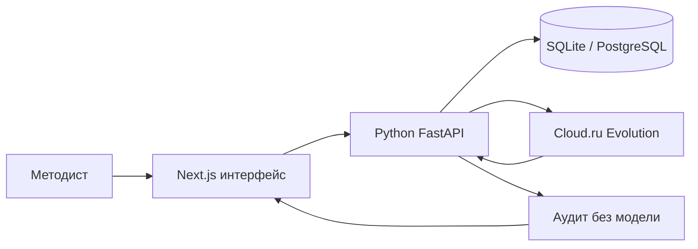

# Студия образовательных программ

Веб-агент для методиста АЦР: запрос и файлы слева, программа справа. Собирает оба шаблона (общеразвивающая и повышение квалификации), любой ИТ-запрос и объём 16–500 часов. Часы, вид программы и коды трудовых функций берутся из слов или файла методиста.

## Насколько закрыто

Сверка с кодом на 19 октября 2026. Это описание сборки, не балл жюри.

| Что проверяют | Состояние |
| --- | --- |
| Соответствие задаче, продукт | Закрыто. Два шаблона АЦР, каркас, комплект, карта компетенций, аудит и файлы DOCX, PPTX, JSON. |
| Продуктовая ценность | Почти. Методист получает программу, которую можно читать и скачивать. Годится ли текст в работу, видно на живом прогоне и на защите. |
| Соответствие задаче, техника | Закрыто. Часы сходятся шагом 0,5. Номер приказа и код трудовой функции из запроса не выдумываются. |
| Покрытие обязательных сценариев | Закрыто в проходе «Новый курс» с ключом. Приём запроса, шаблоны, каркас, карта компетенций, выгрузки и аудит идут этим путём. Текст компетенций, плана, лекций, заданий и тестов пишет модель, пока хватает около трёх минут. Если ключа нет, шлюз замолчал или модель дважды не вернула инструмент, пустые части дописываются по каркасу, и шапка называет источник. «Офлайн-пример» в этот проход не входит. |
| Соблюдение ограничений кейса | Закрыто. Разрешены только два шлюза ниже. Чужой адрес, включая `api.openai.com`, отклоняется до запроса. Ссылка на источник проверяется отдельно, текст страницы не сохраняется. `GET /health` показывает, задан ли ключ и какой хост разрешён. Сам ключ в ответ не попадает. |
| Сквозной сценарий без заглушек | Закрыто в том же проходе. Старт — пустой курс. Миграции Alembic применяются при старте контейнера и командой `npm run backend:migrate`. Локальная фикстура открывается только кнопкой «Офлайн-пример» или ссылкой `?sample=1`. Запасной каркас включается, когда модели нет, и подписывается в шапке. |
| Запуск по инструкции | Закрыто. Ниже таблица ключей, Docker, локальный запуск и те же шаги в студии. `npm run smoke:llm` проверяет ключ и печатает адрес модели. |
| Качество результата | На защите. Доменную логику, защиту от выдумывания и обоснованность текста ставит жюри. |
| Архитектура и возможность развития | Закрыто в этой сборке. Next.js и FastAPI разделены, выгрузка и аудит — отдельные маршруты. Адреса шлюза задаются `OPENAI_*` и `CLOUDRU_*` в `.env` и в Compose. Локально курсы в SQLite, в Docker в PostgreSQL. |
| Обработка ошибок и сбоев | Закрыто. Одна точка повтора — `CloudRuClient`. На каркасе ответ 429 или 5xx повторяется до трёх раз, ожидание шага до 180 секунд. Шаг комплекта ждёт до 70 секунд и не повторяется, чтобы три долгих вызова не съели запас. Методист видит фразу: ключа нет, шлюз молчит, время вышло или API недоступен. |
| Сценарий взаимодействия с пользователем | Закрыто. Файл проверяется до загрузки и на сервере: тип `.txt`, `.md`, `.pdf`, `.docx`, пустой файл, файл больше 8 МБ, файл без текста, битый файл. Долгий чат, разбор файла и выгрузка показывают статус. «Собрать комплект» видна, пока у модуля нет лекции, задания или теста. |
| Подача результата пользователю | Закрыто. DOCX, PPTX и JSON отдаёт `POST /api/export/{json\|docx\|pptx}` и `GET /api/courses/{id}/export/{kind}`. В шапке: «Собираю…», «готов» или «Выгрузка не собралась». Ответ сервера несёт заголовок `X-Studio-Export: ready`. Отдельной очереди нет: файл готовится в этом запросе. Если сервер недоступен, презентация собирается в браузере, и шапка говорит об этом. |
| Финальная защита | На защите. Ценность, внедрение и питч здесь не ставятся. |

## Запуск

Проверяющий проходит сценарий в студии, кнопкой «Новый курс». Скрытый `POST /api/run` и кнопка «Офлайн-пример» в этот проход не входят: пример только показывает уже заполненную программу без модели.

Разрешены два шлюза. Другой адрес, включая `api.openai.com`, код отклоняет до запроса.

```
https://hub.gigaschool.ru/api/v1/llm/v1
https://foundation-models.api.cloud.ru/v1
```

Имена `OPENAI_*` — совместимость с SDK хакатона. Модель писателя: `GigaChat/GigaChat-3-Pro`. Чат ходит только в FastAPI. Если шлюз ответил 429 или 5xx, запрос каркаса повторяется до трёх раз. Комплект с ключом пишет модель, каждый её шаг ждёт до 70 секунд и не повторяется, общий запас около трёх минут. Без ключа или если шлюз замолчал, каркас остаётся, недостающее дописывается по нему, и в чате написано, что текст дописан кодом.

### Откуда взять ключ

Ключ в чат и в репозиторий не кладут. В `.env` заполняют одну пару, вторую оставляют пустой.

| Где запускаете | Откуда ключ | Что записать |
| --- | --- | --- |
| Хакатонная VM | Уже лежит в окружении VM и в кабинете команды GigaSchool | Не копировать пустой `.env` поверх. `OPENAI_API_KEY` и `OPENAI_BASE_URL=https://hub.gigaschool.ru/api/v1/llm/v1` |
| Локально, шлюз хакатона | Кабинет команды GigaSchool, тот же ключ, что на VM | `OPENAI_API_KEY` и `OPENAI_BASE_URL` как в строке выше |
| Локально, Cloud.ru | Личный кабинет [Foundation Models](https://cloud.ru/docs/foundation-models/ug/topics/api-ref) | `CLOUDRU_API_KEY` и `CLOUDRU_BASE_URL=https://foundation-models.api.cloud.ru/v1` |

Проверка ключа без сборки курса печатает адрес и имя модели, сам ключ не печатает:

```bash
npm run smoke:llm
```

Строка `key=set` значит, что ключ прочитан. Код выхода 2 — ключа в `.env` нет.

### Docker

Порт 8000 снаружи один. Его занимают и Docker, и локальный FastAPI: одновременно их не запускают. На личном компьютере этот порт иногда занят редактором; пустой ответ `{"error":"fetch failed"}` значит, что студия не дошла до API.

```bash
cp .env.example .env
docker compose up --build
docker compose ps
```

Дождитесь `db`, `api`, `web`. Compose сам ждёт PostgreSQL и применяет миграции Alembic. Студия: [http://localhost:8000](http://localhost:8000). Swagger: [http://localhost:8000/backend/docs](http://localhost:8000/backend/docs).

Остановка: `docker compose down`. Том `postgres-data` удаляется только через `docker compose down -v`.

На VM:

```bash
cd ~/project
git pull
cp -n .env.example .env
docker compose up -d --build
docker compose ps
```

`cp -n` не затирает уже лежащий ключ. Публичный адрес VM открывает студию на порту 8000. FastAPI и PostgreSQL остаются внутри Docker-сети.

### Локально, без Docker

`.env.example` уже содержит адрес Python и файл SQLite. После копирования их не удаляют.

```bash
cp .env.example .env
npm ci
python -m pip install -r backend/requirements.txt
npm run backend:migrate
```

`npm run backend:migrate` применяет Alembic к `backend/data/studio.db`. Дальше два терминала:

```bash
npm run backend
```

```bash
npm run dev
```

Студия: [http://localhost:3000](http://localhost:3000). Swagger: [http://localhost:8000/docs](http://localhost:8000/docs). Если порт 3000 занят: `npx next dev -p 3010`.

| Переменная | Зачем |
| --- | --- |
| `OPENAI_API_KEY` или `CLOUDRU_API_KEY` | Ключ шлюза. Пусто — комплект собирает код. |
| `OPENAI_BASE_URL` или `CLOUDRU_BASE_URL` | Один из двух адресов выше. |
| `CLOUDRU_MODEL_WRITER` | Модель. Если пусто, берётся `CLOUDRU_MODEL`, затем `GigaChat/GigaChat-3-Pro`. |
| `PYTHON_AGENT_URL` | Куда Next.js отправляет чат. Локально `http://127.0.0.1:8000`. |
| `NEXT_PUBLIC_PYTHON_API_URL` | Куда браузер сохраняет курс. Локально тот же адрес. |
| `DATABASE_URL` | Локально `sqlite:///backend/data/studio.db`. В Docker Compose подставляет PostgreSQL сам. |

### Сценарий в студии

Один и тот же путь на порту 8000 (Docker) и на порту 3000 (локально).

1. «Новый курс». Вставьте неполный запрос про кибербезопасность из `materials/open-cases.txt` (запрос 4, часы не названы). Студия спрашивает тип программы, точные часы, уровень, форму и аттестацию. Число 72 само не появляется.
2. «Новый курс» ещё раз. Вставьте запрос 1 из того же файла: «Первые шаги в Python», 16 часов, школьники 8 и 9 классов. Справа каркас, сумма часов 16. Тестов ещё нет.
3. «Утвердить каркас», затем «Собрать комплект», если кнопка ещё видна. Появляются тест, семинар и слайды. С ключом их пишет модель. Если шлюз молчит или ключа нет, чат прямо пишет, что комплект дописан по каркасу. Когда у каждого модуля есть лекция, задание и тест, кнопка пропадает.
4. «Выгрузить → Программа» скачивает DOCX с сервера. «Презентация» и «Данные» тоже сначала идут в `POST /api/export/...`. Пока файл собирается, в шапке написано «Собираю DOCX на сервере…», затем «DOCX готов». Если сервер недоступен, презентация собирается в браузере, и шапка говорит об этом.
5. Вкладка «Проверка»: часы сходятся, на каждый результат обучения два средства, номер чужого приказа не выдуман.
6. Долгий ответ модели не выглядит зависшим: сначала «Модель думает…», после минуты «Модель пишет комплект. Это может занять несколько минут.» Пустой файл, чужой тип и файл больше 8 МБ отклоняются фразой под полем, без загрузки.

### Офлайн, без модели

Кнопка «Офлайн-пример» подставляет готовую общеразвивающую программу на 24 часа. Прямая ссылка локально: `http://localhost:3000/?sample=1`. Так проверяют часы, компетенции и выгрузки, когда ключа нет. Этот экран не заменяет шаги сценария выше.

## Как собирается программа

Агент сначала собирает каркас: компетенции и учебный план, сумма часов равна объёму. Кнопка «Утвердить каркас» открывает тесты, задания и лекции. Когда вид программы уже известен, студия сама добавляет официальную ссылку. Общеразвивающая программа опирается на приказ Минпросвещения от 27.07.2022 № 629. Программа повышения квалификации опирается на 273-ФЗ и приказ Минобрнауки от 24.03.2025 № 266. Приказ от 01.07.2013 № 499 с 01.09.2025 утратил силу, и вкладка «Проверка» оставляет это предупреждение методисту. Другие приказы и коды трудовых функций агент не выдумывает. Реквизиты приказа организации, ФИО преподавателей и подпись остаются пустыми полями.

## Контракт API

Схема собирается из кода. Локальный Swagger: [http://localhost:8000/docs](http://localhost:8000/docs). В Docker тот же документ на [http://localhost:8000/backend/docs](http://localhost:8000/backend/docs). Машиночитаемый файл локально — [http://localhost:8000/openapi.json](http://localhost:8000/openapi.json).

| Метод и путь | Что проверяет или делает |
| --- | --- |
| `GET /health` | Процесс отвечает. В ответе: задан ли ключ (`llmConfigured`), хост шлюза (`llmHost`) и список выгрузок. Ключ не возвращается. |
| `POST /api/audit` | Без модели: шаблон, сумма часов, шаг 0,5, ключ вопроса, дословный результат обучения, тест и практическое задание на каждый результат, наличие источника. |
| `POST /api/regulatory/check` | Открывает ссылку и смотрит код ответа. Недоступный сайт оставляет приказ неподтверждённым. |
| `POST /api/sources/probe` | Проверяет несколько ссылок. Текст страницы не сохраняется. |
| `POST /api/stack/freshness` | Для названных в программе версий Python, Java, Node.js и соседних продуктов спрашивает срок поддержки на endoflife.date. Ответ сайта не сохраняется. |
| `GET /api/regulatory/policy` | Правила, по которым нельзя выдумывать приказы и профстандарты. |
| `POST /api/chat/turn` | Один ход диалога. Неподтверждённые часы и реквизиты отбрасывает код. |
| `POST /api/run` | Прогон до каркаса. Комплект — после кнопки в студии. `autoApprove: true` только в тестах. Аудит как у `POST /api/audit`. |
| `POST /api/export/{json\|docx\|pptx}` | Сервер собирает файл программы. Браузер его только скачивает. |
| `GET /api/courses/{id}/export/{json\|docx\|pptx}` | То же из последней сохранённой версии. |
| `PUT /api/courses/{id}` | Новая версия курса. Часы вне шага 0,5 и вопрос без ключа не сохраняются. |
| `GET /api/courses/{id}` | Последняя версия, сообщения и источники. |

## Архитектура

Интерфейс — Next.js. Чат, каркас, комплект, аудит, нормативы и `/api/run` идут в один контур — Python FastAPI. Next.js только проксирует запрос; к модели ходит `CloudRuClient` с повтором 429/5xx. Часы, тип программы и коды трудовых функций утверждает код. Параллельное сохранение курса сериализуется блокировкой строки и отклоняет устаревшую версию кодом 409. Локально курсы пишутся в SQLite, в Docker — в PostgreSQL. Если backend недоступен, список курсов остаётся в `localStorage`.



Подробно поток данных описан в [`docs/architecture.md`](docs/architecture.md).

## Нормативные документы

Студия должна работать с документами Минпросвещения России, Минобрнауки России, Минтруда России, Федеральным законом № 273-ФЗ, профстандартами и шаблонами АЦР. Правила:

- документ берётся из файла методиста или по проверяемой ссылке;
- общеразвивающая программа получает ссылку на официальное опубликование приказа № 629: `http://publication.pravo.gov.ru/document/0001202209270013`;
- программа повышения квалификации получает 273-ФЗ (`http://publication.pravo.gov.ru/document/0001201212300007`) и приказ № 266 (`http://publication.pravo.gov.ru/document/0001202504230011`);
- приказ № 499 остаётся в предупреждении: он назван в исходном требовании и утратил силу с 01.09.2025, методист подтверждает, какой порядок оставить;
- код трудовой функции у компетенции повышения квалификации берётся из профстандарта методиста;
- название, номер, дата приказа и код трудовой функции не придумываются;
- источник сохраняется в `brief.references` и попадает в отчёт, JSON и DOCX;
- неподтверждённые реквизиты помечаются и не считаются проверенными;
- текст приказа в студию не скачивается: в момент проверки открывается ссылка, сохраняются код ответа и отметка страницы (ETag, дата изменения и хеш первых 64 КБ);
- если отметка страницы изменилась с прошлой проверки на этом компьютере, вкладка «Проверка» показывает предупреждение. Методист открывает ссылку и сверяет документ сама; после сверки новая отметка запоминается;
- если сайт не ответил, документ остаётся неподтверждённым и не заменяется старой копией;
- применимость документа и финальную редакцию подтверждает методист.

`POST /api/regulatory/check` и `POST /api/sources/probe` открывают ссылку и смотрят код ответа. Документ не объявляется действующим. Если сайт недоступен, статус остаётся неподтверждённым.

Проверки часов, брифа, аудита курса, экспортов и схем инструментов:

```bash
npm test
```

Локальные проверки: `npm test`, `python -m pytest backend/tests -q` и `npm run build`. Покрытие выгрузки тестов: `npm run test:coverage`, отчёт открывается в `coverage/index.html`. Живой прогон без браузера:

```bash
npm run dev
# в другом терминале
node scripts/run-cases.mjs 4
# скрытый прогон с комплектом: POST /api/run  { "request": "...", "autoApprove": true }
```

Материалы кейса лежат в `materials/`. В репозитории сохранены исходные `.docx` и их текстовые извлечения `.txt`.

- `program-general-24h` — интенсив, 24 часа
- `program-qualification-248h` — стажировка, 248 часов
- `open-cases` — пять открытых запросов и чек-листы

Ноутбук запускается из папки `notebooks`. Для ячеек аудита должен работать FastAPI на порту 8000:

```bash
cd notebooks
jupyter notebook solution.ipynb
```

## Что делает студия

- Оба шаблона АЦР, любой запрос методиста, объём 16–500 часов. Неполный запрос сначала задаёт вопросы. Слово «месяц» само не становится числом часов.
- Файл и ссылка принимаются как образец структуры. Тема и часы образца остаются в образце. Код трудовой функции переносится из файла методиста.
- Карта компетенций связана с темами, тестом и заданием. Учебный план сходится по часам, шаг 0,5.
- После утверждения каркаса собираются тест с ключами, семинар с критериями и слайды. DOCX, PPTX и JSON сначала отдаёт FastAPI (`/api/export/...`), статус виден в шапке. Moodle XML, GIFT и CSV собирает браузер.
- Вкладка «Проверка» и `POST /api/audit` смотрят суммы часов, два оценочных средства на результат и обязательные основания. Приказ № 499 помечается как утративший силу.
- «Мои курсы» хранит версии. «Копия» берёт новую аудиторию и объём, исходный курс остаётся как был.

## Что проверить руками

Тот же сценарий глазами, на VM с ключом. Скрытый `/api/run` в этот проход не входит. Пункты 1–3 и 6–7 повторяют раздел «Сценарий в студии»; 4, 5, 8 и 9 — соседние края.

1. `docker compose ps` — `db`, `api`, `web` healthy. Браузер открывает студию на `:8000`, не пустой `fetch failed`.
2. «Новый курс». Неполный запрос про кибербезопасность из `materials/open-cases`. Студия спрашивает тип, часы, уровень, форму, аттестацию. «Месяц» не становится часами.
3. Case 1: «Первые шаги в Python», 16 ч. Каркас сходится. Без кнопки «Утвердить каркас» тестов нет. После кнопки — 10 вопросов, слайды, семинар, не «что верно про тему».
4. Case 2 или 3: приложить образец 248 ч, в запросе свои часы (36 или 72). В программе объём из запроса, не 248. Тема из запроса, не из образца.
5. Чужая тема (Figma, 1С, архив) — модули про эту тему, не каталог Python/DevOps.
6. Вкладка «Проверка»: часы сходятся, два средства на результат обучения, приказ не выдуман.
7. «Выгрузить → Программа / Презентация / Данные» — файлы с сервера. В Swagger те же `POST /api/export/docx`. Это программа, не пустой шаблон.
8. Без ключа (временно убрать `OPENAI_API_KEY` из контейнера или локально): «Офлайн-пример» и новый курс не падают. После утверждения комплект появляется, в чате написано «Ключа шлюза нет».
9. Ошибка модели не рвёт экран: чат отвечает текстом, каркас не пропадает, кнопка «Утвердить» на месте.

## Holix

Чат студии ходит в Cloud.ru Evolution. Holix подключается к репозиторию как помощник: при запуске из этой папки он читает `.holix/HOLIX.md` и навык `.holix/skills/edu-methodist`. Проверка часов и правка секции живут в самой студии.
