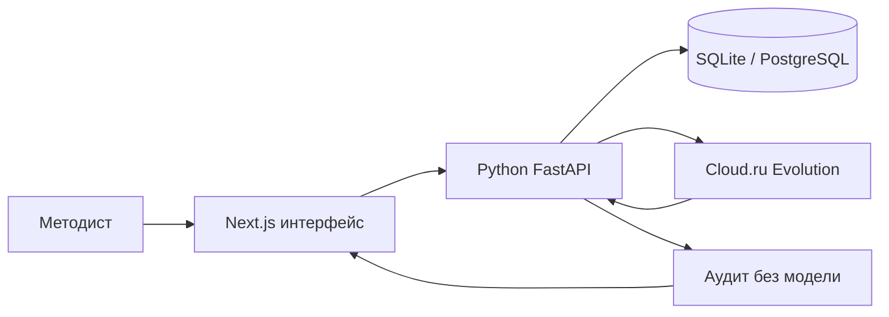

# Студия образовательных программ

Веб-агент для методиста АЦР: запрос и файлы слева, программа справа. Собирает оба шаблона (общеразвивающая и повышение квалификации), любой ИТ-запрос и объём 16–500 часов. Часы и коды трудовых функций берёт только из слов или файла методиста.

## Запуск

Один рабочий путь — Docker. Наружу только порт 8000.

```bash
cp .env.example .env
docker compose up --build
```

Студия: [http://localhost:8000](http://localhost:8000). FastAPI: [http://localhost:8000/backend/docs](http://localhost:8000/backend/docs). Compose поднимает Next.js, FastAPI и PostgreSQL, ждёт БД и применяет миграции Alembic. Порт 8000 должен быть свободен: на хакатонной VM он свободен, на личном компьютере его иногда занимает редактор.

Без ключа студия не обрывается: принимает запрос и файл, собирает каркас, после кнопки «Утвердить каркас» дописывает комплект кодом, отдаёт аудит и выгрузки. Живой текст лекций и теста пишет модель — для этого нужен ключ.

### Ключ модели

Разрешены только два шлюза. Другие адреса, включая `api.openai.com`, код отклоняет.

```
https://hub.gigaschool.ru/api/v1/llm/v1
https://foundation-models.api.cloud.ru/v1
```

Имена `OPENAI_*` — совместимость с SDK хакатона, не зарубежный хост. На VM эти переменные уже заданы и указывают на GigaSchool; `docker compose` передаёт их в контейнер `api`. Локально скопируйте `.env.example` и вставьте ключ из кабинета команды, не в чат.

```
OPENAI_API_KEY=...
OPENAI_BASE_URL=https://hub.gigaschool.ru/api/v1/llm/v1
```

или те же значения в `CLOUDRU_*`. Модель: `GigaChat/GigaChat-3-Pro`. Чат и `/api/run` ходят только в FastAPI. Если модель не ответила (429, 5xx), клиент повторяет запрос до трёх раз; если ключа нет — комплект собирает код.

Остановка: `docker compose down`. Том `postgres-data` удаляется только через `docker compose down -v`.

### Основной сценарий по инструкции

Проверяющий проходит этот путь в студии, не через скрытый `/api/run`.

1. Скопируйте `.env.example` в `.env`. На VM ключ уже есть — не затирайте. Локально вставьте `OPENAI_API_KEY` из кабинета команды. `OPENAI_BASE_URL` оставьте `https://hub.gigaschool.ru/api/v1/llm/v1`.
2. `docker compose up --build`. Дождитесь `db`, `api`, `web` в `docker compose ps`.
3. Откройте [http://localhost:8000](http://localhost:8000) или публичный адрес VM. Пустой `{"error":"fetch failed"}` значит, что порт 8000 занят редактором — на VM его нет.
4. «Новый курс». Вставьте запрос из `materials/open-cases.txt` (кибербезопасность без часов). Студия задаёт вопросы, не подставляет 72 часа.
5. Ответьте или вставьте полный Case 1: «Первые шаги в Python», 16 часов. Справа появится каркас, сумма часов сходится. Тестов ещё нет.
6. Нажмите «Утвердить каркас». Появится комплект: тест, семинар, слайды.
7. «Выгрузить → Программа» качает DOCX с сервера (`POST /api/export/docx`). «Презентация» — PPTX, «Данные» — JSON. Те же файлы: Swagger [http://localhost:8000/backend/docs](http://localhost:8000/backend/docs) или `GET /api/courses/{id}/export/docx` после сохранения.
8. Вкладка «Проверка» — часы и два средства на результат обучения. Приказ не выдуман.

### Хакатонная VM

```bash
cd ~/project
git pull
cp -n .env.example .env
docker compose up -d --build
docker compose ps
```

Публичный адрес VM открывает студию на порту 8000. FastAPI и PostgreSQL остаются внутри Docker-сети. Если `OPENAI_API_KEY` уже есть в окружении VM, не затирайте его пустым `.env`.

## Локальный запуск

Модель курса — [Foundation Models в Cloud.ru Evolution](https://cloud.ru/docs/foundation-models/ug/topics/api-ref) или шлюз GigaSchool. В `.env` нужен API-ключ из личного кабинета и один из двух URL выше. Без ключа работают пример, проверка часов, приём файлов и выгрузки. Для генерации используется `CLOUDRU_MODEL_WRITER`, а при его отсутствии — `CLOUDRU_MODEL`. Чат и `/api/run` без `PYTHON_AGENT_URL` не стартуют: Next.js сам модель не вызывает.

```
CLOUDRU_API_KEY=...
CLOUDRU_BASE_URL=https://foundation-models.api.cloud.ru/v1
CLOUDRU_MODEL=GigaChat/GigaChat-3-Pro
CLOUDRU_MODEL_WRITER=GigaChat/GigaChat-3-Pro
```

Агент сначала собирает каркас: компетенции и учебный план, сумма часов равна объёму. Кнопка «Утвердить каркас» открывает тесты, задания и лекции. Когда вид программы уже известен, студия сама добавляет официальную ссылку. Общеразвивающая программа опирается на приказ Минпросвещения от 27.07.2022 № 629. Программа повышения квалификации опирается на 273-ФЗ и приказ Минобрнауки от 24.03.2025 № 266. Приказ от 01.07.2013 № 499 с 01.09.2025 утратил силу, и вкладка «Проверка» оставляет это предупреждение методисту. Другие приказы и коды трудовых функций агент не выдумывает. Реквизиты приказа организации, ФИО преподавателей и подпись остаются пустыми полями.

Подготовьте оба контура:

```bash
cp .env.example .env
npm ci
python -m pip install -r backend/requirements.txt
npm run backend:migrate
```

Запустите FastAPI:

```bash
npm run backend
```

В другом терминале запустите интерфейс:

```bash
npm run dev
```

Студия открывается на [http://localhost:3000](http://localhost:3000), Swagger — на [http://localhost:8000/docs](http://localhost:8000/docs). Кнопка «Пример 24 ч» показывает заполненную студию без модели; прямая ссылка — `http://localhost:3000/?sample=1`.

Чтобы Next.js направлял чат и сохранение версий в Python, в `.env` должны быть:

```env
PYTHON_AGENT_URL=http://127.0.0.1:8000
NEXT_PUBLIC_PYTHON_API_URL=http://127.0.0.1:8000
DATABASE_URL=sqlite:///backend/data/studio.db
```

Если порт 3000 занят, запустите `npx next dev -p 3010` и откройте `http://localhost:3010/?sample=1`.

## Контракт API

Схема собирается из кода и открывается в Swagger UI: [http://localhost:8000/docs](http://localhost:8000/docs). Машиночитаемый документ — [http://localhost:8000/openapi.json](http://localhost:8000/openapi.json).

| Метод и путь | Что проверяет или делает |
| --- | --- |
| `GET /health` | Процесс отвечает. |
| `POST /api/audit` | Без модели: шаблон, сумма часов, шаг 0,5, ключ вопроса, дословный результат обучения, тест и практическое задание на каждый результат, наличие источника. |
| `POST /api/regulatory/check` | Открывает ссылку и смотрит код ответа. Недоступный сайт оставляет приказ неподтверждённым. |
| `POST /api/sources/probe` | Проверяет несколько ссылок. Текст страницы не сохраняется. |
| `POST /api/stack/freshness` | Для названных в программе версий Python, Java, Node.js и соседних продуктов спрашивает срок поддержки на endoflife.date. Ответ сайта не сохраняется. |
| `GET /api/regulatory/policy` | Правила, по которым нельзя выдумывать приказы и профстандарты. |
| `POST /api/chat/turn` | Один ход диалога. Неподтверждённые часы и реквизиты отбрасывает код. |
| `POST /api/run` | Прогон до каркаса. Комплект — после кнопки в студии. `autoApprove: true` только в тестах. Аудит как у `POST /api/audit`. |
| `POST /api/export/{json\|docx\|pptx}` | Сервер собирает файл программы. Браузер его только скачивает. |
| `GET /api/courses/{id}/export/{json\|docx\|pptx}` | То же из последней сохранённой версии. |
| `PUT /api/courses/{id}` | Новая версия курса. Часы вне шага 0,5 и вопрос без ключа не сохраняются. |
| `GET /api/courses/{id}` | Последняя версия, сообщения и источники. |

## Архитектура

Интерфейс — Next.js. Чат, каркас, комплект, аудит, нормативы и `/api/run` идут в один контур — Python FastAPI. Next.js только проксирует запрос; к модели ходит `CloudRuClient` с повтором 429/5xx. Часы, тип программы и коды трудовых функций утверждает код. Параллельное сохранение курса сериализуется блокировкой строки и отклоняет устаревшую версию кодом 409. Локально курсы пишутся в SQLite, в Docker — в PostgreSQL. Если backend недоступен, список курсов остаётся в `localStorage`.



Подробно поток данных описан в [`docs/architecture.md`](docs/architecture.md).

## Нормативные документы

Студия должна работать с документами Минпросвещения России, Минобрнауки России, Минтруда России, Федеральным законом № 273-ФЗ, профстандартами и шаблонами АЦР. Правила:

- документ берётся из файла методиста или по проверяемой ссылке;
- общеразвивающая программа получает ссылку на официальное опубликование приказа № 629: `http://publication.pravo.gov.ru/document/0001202209270013`;
- программа повышения квалификации получает 273-ФЗ (`http://publication.pravo.gov.ru/document/0001201212300007`) и приказ № 266 (`http://publication.pravo.gov.ru/document/0001202504230011`);
- приказ № 499 остаётся в предупреждении: он назван в исходном требовании и утратил силу с 01.09.2025, методист подтверждает, какой порядок оставить;
- код трудовой функции у компетенции повышения квалификации берётся из профстандарта методиста;
- название, номер, дата приказа и код трудовой функции не придумываются;
- источник сохраняется в `brief.references` и попадает в отчёт, JSON и DOCX;
- неподтверждённые реквизиты помечаются и не считаются проверенными;
- текст приказа в студию не скачивается: в момент проверки открывается ссылка, сохраняются код ответа и отметка страницы (ETag, дата изменения и хеш первых 64 КБ);
- если отметка страницы изменилась с прошлой проверки на этом компьютере, вкладка «Проверка» показывает предупреждение. Методист открывает ссылку и сверяет документ сама; после сверки новая отметка запоминается;
- если сайт не ответил, документ остаётся неподтверждённым и не заменяется старой копией;
- применимость документа и финальную редакцию подтверждает методист.

`POST /api/regulatory/check` и `POST /api/sources/probe` открывают ссылку и смотрят код ответа. Документ не объявляется действующим. Если сайт недоступен, статус остаётся неподтверждённым.

Проверки часов, брифа, аудита курса, экспортов и схем инструментов:

```bash
npm test
```

Локальные проверки: `npm test`, `python -m pytest backend/tests -q` и `npm run build`. Покрытие выгрузки тестов: `npm run test:coverage`, отчёт открывается в `coverage/index.html`. Живой прогон без браузера:

```bash
npm run dev
# в другом терминале
node scripts/run-cases.mjs 4
# скрытый прогон с комплектом: POST /api/run  { "request": "...", "autoApprove": true }
```

Материалы кейса лежат в `materials/`. В репозитории сохранены исходные `.docx` и их текстовые извлечения `.txt`.

- `program-general-24h` — интенсив, 24 часа
- `program-qualification-248h` — стажировка, 248 часов
- `open-cases` — пять открытых запросов и чек-листы

Ноутбук запускается из папки `notebooks`. Для ячеек аудита должен работать FastAPI на порту 8000:

```bash
cd notebooks
jupyter notebook solution.ipynb
```

## Что делает студия

- Оба шаблона АЦР, любой запрос методиста, объём 16–500 часов. Неполный запрос — сначала вопросы, «месяц» не становится часами.
- Файл и ссылка принимаются как образец структуры. Тема и часы образца не копируются. Код трудовой функции переносится только из файла.
- Карта компетенций связана с темами, тестом и заданием. Учебный план сходится по часам, шаг 0,5.
- После утверждения каркаса собираются тест с ключами, семинар с критериями и слайды. Выгрузки DOCX, PPTX и JSON отдаёт FastAPI (`/api/export/...`). Moodle XML, GIFT и CSV собирает браузер.
- Вкладка «Проверка» и `POST /api/audit` смотрят суммы часов, два оценочных средства на результат и обязательные основания. Приказ № 499 помечается как утративший силу.
- «Мои курсы» хранит версии. «Копия» берёт новую аудиторию и объём, исходный курс не затирается.

## Что проверить руками

Завтра утром, на VM, с ключом. Один проход глазами — не скрытый `/api/run`.

1. `docker compose ps` — `db`, `api`, `web` healthy. Браузер открывает студию на `:8000`, не пустой `fetch failed`.
2. «Новый курс». Неполный запрос про кибербезопасность из `materials/open-cases`. Студия спрашивает тип, часы, уровень, форму, аттестацию. «Месяц» не становится часами.
3. Case 1: «Первые шаги в Python», 16 ч. Каркас сходится. Без кнопки «Утвердить каркас» тестов нет. После кнопки — 10 вопросов, слайды, семинар, не «что верно про тему».
4. Case 2 или 3: приложить образец 248 ч, в запросе свои часы (36 или 72). В программе объём из запроса, не 248. Тема из запроса, не из образца.
5. Чужая тема (Figma, 1С, архив) — модули про эту тему, не каталог Python/DevOps.
6. Вкладка «Проверка»: часы сходятся, два средства на результат обучения, приказ не выдуман.
7. «Выгрузить → Программа / Презентация / Данные» — файлы с сервера. В Swagger те же `POST /api/export/docx`. Это программа, не пустой шаблон.
8. Без ключа (временно убрать `OPENAI_API_KEY` из контейнера или локально): «Пример 24 ч» и новый курс не падают. После утверждения комплект всё равно появляется.
9. Ошибка модели не рвёт экран: чат отвечает текстом, каркас не пропадает, кнопка «Утвердить» на месте.

## Holix

Чат студии ходит в Cloud.ru Evolution. Holix подключается к репозиторию как помощник: при запуске из этой папки он читает `.holix/HOLIX.md` и навык `.holix/skills/edu-methodist`. Проверка часов и правка секции живут в самой студии.
