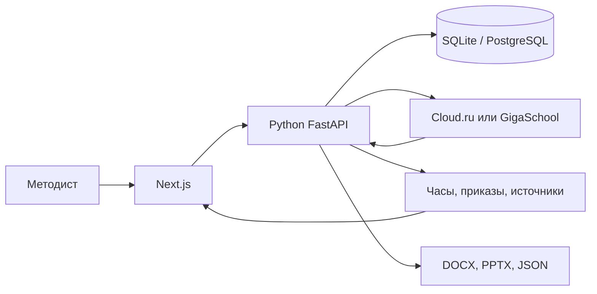

# Студия образовательных программ

Рабочее место методиста АЦР. Слева программа, справа чат. Методист приносит запрос на ИТ-курс, студия собирает программу по одному из двух шаблонов АЦР и отдаёт файлы, которые можно открыть и проверить.

Общеразвивающая программа завершается сертификатом. Программа повышения квалификации завершается удостоверением. Объём от 16 академических часов, верхнего предела нет: длинный курс пишется модулями-блоками. Часы, вид программы и коды трудовых функций берутся из слов методиста или из приложенного файла.

Быстрый прогон для проверяющего: [docs/REPRODUCIBILITY.md](docs/REPRODUCIBILITY.md). Шпаргалка к защите на 5 минут: [docs/JURY.md](docs/JURY.md).

## Что получает методист

1. **Запрос.** Неполный запрос не становится программой. Студия спрашивает тип, точные часы, слушателей и их уровень, форму обучения и итоговую аттестацию. На тип, аттестацию и форму можно нажать кнопку и отправить несколько ответов одним сообщением. Слушателей пишут текстом. Слово «месяц» остаётся сроком и не превращается в часы.
2. **Каркас.** Когда бриф собран, модель пишет компетенции и учебный план. Компетенции показаны как знания, умения и навыки. Сумма часов модулей и аттестации равна объёму, шаг 0,5. Лекции, семинары и тесты на этом шаге закрыты.
3. **Комплект.** Кнопка «Утвердить каркас» открывает содержание. «Собрать комплект» дописывает тест с ключами, практические задания и слайды. Пока у модуля нет лекции, задания или теста, кнопка остаётся.
4. **Проверка и файлы.** Вкладка «Проверка» смотрит часы, два оценочных средства на каждый результат обучения и источники. «Выгрузить» отдаёт DOCX, PPTX и JSON с сервера. Moodle XML, GIFT и CSV собирает браузер.

«Мои курсы» хранит версии. «Копия» заводит новый курс под другую аудиторию и объём, исходный остаётся. «Офлайн-пример» открывает одну и ту же готовую программу на 24 часа, без модели и без нового экземпляра на каждый клик.

Пока модель пишет, в шапке идёт тонкая линия хода и подпись с оставшимся временем. В чате после ответа виден расход токенов этого хода.

## Кто что пишет

Модель пишет формулировки: компетенции, модули, лекции, задания и тест. Код не выпускает программу, пока не сошлись часы, шаблон и источники.

- Часы и тип программы проходят, только если методист их назвал.
- Номер приказа и код трудовой функции не выдумываются. Их берут из файла или из проверяемой ссылки.
- Тема и часы приложенного образца остаются в образце. В программу попадает объём из запроса.
- Если ключа нет или шлюз замолчал, пустые места дописываются по каркасу, и чат прямо говорит, что текст дописан кодом.
- Лекции, семинары и тесты не собираются, пока методист не утвердил каркас.

В Docker ход чата встаёт в Redis, его забирает воркер Celery. Одновременно к модели уходит не больше `GATEWAY_CONCURRENCY` запросов, бюджет токенов один на очередь. Без `REDIS_URL` или без живого воркера ход идёт в процессе API. Кнопка «Голос» кладёт расшифровку в поле запроса. Звук разбирает локальная GigaAM, не шлюз чата, и в студию не сохраняется. Поиск по файлам методиста и объектное хранилище в показ не входят. Список в [docs/architecture.md](docs/architecture.md).

## Запуск

Проверяющий идёт кнопкой «Новый курс». `POST /api/run` и «Офлайн-пример» в этот проход не входят: пример только показывает уже заполненную программу.

Разрешены два шлюза. Другой адрес, включая `api.openai.com`, код отклоняет до запроса.

```
https://hub.gigaschool.ru/api/v1/llm/v1
https://foundation-models.api.cloud.ru/v1
```

Имена `GIGASCHOOL_*` оставлены для SDK хакатона. Модель писателя: `GigaChat/GigaChat-3-Pro`. Чат ходит только в FastAPI. На каркасе ответ 429 или 5xx повторяется до трёх раз, шаг ждёт до 180 секунд. Шаг комплекта ждёт до 70 секунд и не повторяется. Общий запас комплекта около трёх минут.

### Ключ

Ключ в чат и в репозиторий не кладут. В `.env` заполняют одну пару, вторую оставляют пустой. Если заполнены обе, процесс берёт `CLOUDRU_API_KEY` и не отправляет `GIGASCHOOL_API_KEY`.

| Где запускаете | Откуда ключ | Что записать |
| --- | --- | --- |
| Хакатонная VM | Кабинет команды GigaSchool | `GIGASCHOOL_API_KEY` и `GIGASCHOOL_BASE_URL` |
| Локально, шлюз хакатона | Тот же ключ, что на VM | `GIGASCHOOL_API_KEY` и `GIGASCHOOL_BASE_URL` |
| Локально, Cloud.ru | [Foundation Models](https://cloud.ru/docs/foundation-models/ug/topics/api-ref) | `CLOUDRU_API_KEY` и `CLOUDRU_BASE_URL=https://foundation-models.api.cloud.ru/v1` |

Проверка ключа печатает адрес и имя модели, сам ключ не печатает:

```bash
npm run smoke:llm
```

`key=set` значит, что ключ прочитан. Код выхода 2 — ключа в `.env` нет.

### Голос

Кнопка «Голос» не ходит в шлюз чата. Запись разбирает локальная [GigaAM](https://github.com/salute-developers/GigaAM), модель `v3_e2e_rnnt`, не дольше 25 секунд. Нужны ffmpeg и отдельная установка:

```bash
python -m pip install -r backend/requirements-speech.txt
```

Первый запуск скачивает веса модели. Ключ Cloud.ru для этого не нужен. Если пакета нет, чат работает, а кнопка пишет, что GigaAM не установлена.

### Docker

Порт 8000 снаружи один. Его занимают и Docker, и локальный FastAPI: одновременно их не запускают. Пустой ответ `{"error":"fetch failed"}` значит, что студия не дошла до API.

```bash
cp -n .env.example .env
python3 -c 'import secrets; print(secrets.token_hex(32))'
```

В `.env`:

- `STUDIO_API_TOKEN` — вставьте сгенерированный токен.
- Один ключ шлюза и его адрес.

Без `STUDIO_API_TOKEN` Compose не стартует. Без ключа модели комплект собирает код и пишет об этом в чат.

```bash
docker compose up -d --build
docker compose ps
```

Дождитесь `db`, `api`, `web`. Compose ждёт PostgreSQL и применяет миграции Alembic. Студия: [http://localhost:8000](http://localhost:8000). Swagger: [http://localhost:8000/backend/docs](http://localhost:8000/backend/docs).

Остановка: `docker compose down`. Том `postgres-data` удаляется только через `docker compose down -v`.

На VM:

```bash
cd ~/project
git pull
cp -n .env.example .env
docker compose up -d --build
docker compose ps
```

`cp -n` не затирает уже лежащий ключ. Публичный адрес VM открывает студию на порту 8000.

### Локально, без Docker

```bash
cp .env.example .env
npm ci
python -m pip install -r backend/requirements.txt
npm run backend:migrate
```

Дальше два терминала: `npm run backend` и `npm run dev`.

Студия: [http://localhost:3000](http://localhost:3000). Swagger: [http://localhost:8000/docs](http://localhost:8000/docs). Если порт 3000 занят: `npx next dev -p 3010`.

| Переменная | Зачем |
| --- | --- |
| `GIGASCHOOL_API_KEY` или `CLOUDRU_API_KEY` | Ключ шлюза. Пусто — комплект собирает код. |
| `GIGASCHOOL_BASE_URL` или `CLOUDRU_BASE_URL` | Один из двух адресов выше. |
| `CLOUDRU_MODEL_WRITER` | Модель. Если пусто, берётся `CLOUDRU_MODEL`, затем `GigaChat/GigaChat-3-Pro`. |
| `PYTHON_AGENT_URL` | Куда Next.js отправляет чат. Локально `http://127.0.0.1:8000`. |
| `NEXT_PUBLIC_PYTHON_API_URL` | Куда браузер сохраняет курс. Локально тот же адрес. |
| `DATABASE_URL` | Локально `sqlite:///backend/data/studio.db`. В Compose подставляется PostgreSQL. |

## Внедрение

Короткий runbook для закрытой техзащиты. Полный сценарий демо — ниже, в «Сценарий на техничке».

### Поднять

```bash
cp -n .env.example .env
# заполнить обязательные переменные (имена ниже, значения — свои)
docker compose up -d --build
docker compose ps
curl -sS http://localhost:8000/backend/health
```

Студия: http://localhost:8000  
Миграции Alembic на старте контейнера `api` автоматически (`alembic upgrade head` в CMD).

### Обязательные env (только имена)

- `STUDIO_API_TOKEN`, `STUDIO_JWT_SECRET`
- `POSTGRES_DB`, `POSTGRES_USER`, `POSTGRES_PASSWORD`
- `REDIS_PASSWORD`
- ключ LLM: `GIGASCHOOL_API_KEY` + `GIGASCHOOL_BASE_URL` **или** `CLOUDRU_API_KEY` + `CLOUDRU_BASE_URL`

Опционально: `CLOUDRU_MODEL` / `CLOUDRU_MODEL_WRITER`, `GATEWAY_CONCURRENCY`, `LLM_TOKEN_BUDGET`.

### Сервисы и worker

Compose поднимает `db`, `redis`, `api`, `worker`, `web`.  
**Worker обязателен:** без Celery-worker ход чата в Docker не выполняется (очередь через Redis).

### Health и логи

- Health: GET http://localhost:8000/backend/health (прокси web → api /health)
- Логи: docker compose logs -f --tail=200 api worker web
- Статус: docker compose ps — api, web и worker должны быть healthy (у worker — celery inspect ping)

- Узкий E2E smoke (без UI-логина): `npm run smoke:e2e` → `scripts/smoke-e2e.py` — health → brief (fixture) → audit → export json/docx через `http://localhost:8000/backend`. Auth stub не gate.
- Если smoke красный: `docker compose ps` (api/web/worker healthy), затем `docker compose logs --tail=100 api web`; проверьте `STUDIO_API_TOKEN` в `.env` (токен прокси, не логин методиста).


### Архитектура (проверка без авторизации)

Логин/SSO не нужны — заглушки на будущее. Проверка по Docker и pytest:

1. Non-root api/worker: `docker compose exec api id` и `docker compose exec worker id` — пользователь `app`, uid `10001` (не root).
2. JSON-логи: `LOG_FORMAT=json` (по умолчанию в Compose). `docker compose logs --tail=30 api` — строки JSON с `time`, `level`, `service`, `requestId` или `jobId`; токены и текст брифа в лог не пишутся.
3. Идемпотентность очереди: `python -m pytest backend/tests/test_gateway_queue.py -k idempotent -q` — повтор `execute_chat_job` не вызывает `run_turn` дважды. В Redis `begin` через `SET NX`; Celery `task_acks_late` и `task_reject_on_worker_lost`.


### Что проверяет код, а что — человек

Код валидирует часы и суммы, покрытие результатов, источники/ссылки и шаблонность («Смысл»). Целиком смысл программы и применимость норм подтверждает методист — студия не подписывает за него.

#### Парсер и валидатор часов (ветка `valentinka`)

Парсер в `backend/app/brief_guard.py` без LLM достаёт из запроса объём курса, часы аттестации, вид программы и ограничения по видам занятий («практики не менее 20 ч», «лекций не более 10», «ровно 8 ч самостоятельной»); опечатки правятся, «месяц» или срок часами не считается. Валидатор `backend/app/curriculum_rules/validator.py` проверяет, что ограничения не противоречат друг другу (min > max, два разных «ровно») и помещаются в общий объём за вычетом аттестации. Рекомендуемое распределение нагрузки по формату берётся из `curriculum_rules/profiles.py` и `workload_profiles.json`, нормативные рамки — из `curriculum_rules/regulations.py`. Тесты: `test_brief_hours_parser.py`, `test_hour_constraints_parser.py`, `test_hour_constraints_guard.py`, `test_allocated_hours_validator.py`, `test_hour_allocation.py`, `test_regulations.py`. Код ловит арифметику и противоречия; уместность распределения часов и применимость норм подтверждает методист.

### После стоп-кода

Код не меняем. Только демо, питч и правки текста при необходимости.

### Next 2 спринта

S3 для артефактов; метрики токенов на боевых прогонах.

## Сценарий на техничке

Десять минут, живой экран: [docs/technicka-10min.md](docs/technicka-10min.md). Шесть минут — один проход от пустого курса до каркаса, четыре — вопросы про код, токены и отказ выдумывать.

Один и тот же путь на порту 8000 и на порту 3000. Нужен ключ.

1. `docker compose ps`: `db`, `api`, `web` в состоянии healthy. Браузер открывает студию, не пустой `fetch failed`.
2. «Новый курс». Неполный запрос про кибербезопасность из `materials/open-cases.txt`, запрос 4. На экране вопросы. Числа 72 нет. «Месяц» не становится часами.
3. «Новый курс» ещё раз. Запрос 1: «Первые шаги в Python», 16 часов, школьники 8 и 9 классов. Справа каркас, сумма 16. Тестов ещё нет.
4. «Утвердить каркас», затем «Собрать комплект». Появляются 10 вопросов, семинар и слайды. В чате видно, что текст написала модель. Если шлюз молчит, чат пишет, что комплект дописан по каркасу.
5. Запрос со своими часами (36 или 72) и приложенным образцом на 248 часов. В программе объём из запроса. Тема из запроса.
6. Чужая тема, например Figma. Модули про эту тему.
7. Вкладка «Проверка»: часы сходятся, два средства на результат обучения, чужой приказ не выдуман.
8. «Выгрузить → Программа / Презентация / Данные». Файлы приходят с сервера. Пока файл собирается, в шапке «Собираю…», затем «готов». Если сервер недоступен, презентация собирается в браузере, и шапка говорит об этом.
9. Без ключа студия не падает. «Офлайн-пример» открывает ту же программу на 24 часа. После утверждения каркаса комплект появляется, в чате написано «Ключа шлюза нет».

Пустой файл, чужой тип и файл больше 8 МБ отклоняются фразой под полем. Долгий ответ сначала подписан «Модель думает…», после минуты — «Модель пишет комплект. Это может занять несколько минут.»

## Как устроена сборка

Интерфейс — Next.js. Чат, каркас, комплект, аудит и выгрузки идут в Python FastAPI. К модели ходит `CloudRuClient`. Часы, тип программы и коды трудовых функций утверждает код. Параллельное сохранение курса отклоняет устаревшую версию кодом 409. Локально курсы лежат в SQLite, в Docker — в PostgreSQL. Если backend недоступен, список курсов остаётся в браузере.



Подробный поток и роадмап: [docs/architecture.md](docs/architecture.md).

Когда вид программы уже известен, студия сама добавляет официальную ссылку.

- Общеразвивающая программа опирается на приказ Минпросвещения от 27.07.2022 № 629: `http://publication.pravo.gov.ru/document/0001202209270013`.
- Повышение квалификации опирается на 273-ФЗ (`http://publication.pravo.gov.ru/document/0001201212300007`) и приказ Минобрнауки от 24.03.2025 № 266 (`http://publication.pravo.gov.ru/document/0001202504230011`).
- Приказ от 01.07.2013 № 499 с 01.09.2025 утратил силу. Вкладка «Проверка» оставляет это предупреждение, методист решает, какой порядок оставить.
- Реквизиты приказа организации, ФИО преподавателей и подпись остаются пустыми полями.

Источник сохраняется в `brief.references` и попадает в отчёт, JSON и DOCX. Текст приказа в студию не скачивается: открывается ссылка, сохраняются код ответа и отметка страницы. Если сайт не ответил, документ остаётся неподтверждённым. Применимость подтверждает методист.

## Контракт API

Схема собирается из кода. Локальный Swagger: [http://localhost:8000/docs](http://localhost:8000/docs). В Docker: [http://localhost:8000/backend/docs](http://localhost:8000/backend/docs).

| Метод и путь | Что делает |
| --- | --- |
| `GET /health` | Процесс отвечает. В ответе: задан ли ключ (`llmConfigured`), хост шлюза (`llmHost`) и список выгрузок. Ключ не возвращается. |
| `POST /api/chat/turn` | Один ход диалога. Неподтверждённые часы и реквизиты отбрасывает код. |
| `POST /api/audit` | Без модели: шаблон, сумма часов, шаг 0,5, ключ вопроса, дословный результат обучения, тест и задание на каждый результат, наличие источника. |
| `POST /api/regulatory/check` | Открывает ссылку и смотрит код ответа. Недоступный сайт оставляет приказ неподтверждённым. |
| `POST /api/sources/probe` | Проверяет несколько ссылок. Текст страницы не сохраняется. |
| `POST /api/stack/freshness` | Для названных версий Python, Java, Node.js и соседних продуктов спрашивает срок поддержки на endoflife.date. Ответ сайта не сохраняется. |
| `GET /api/regulatory/policy` | Правила, по которым нельзя выдумывать приказы и профстандарты. |
| `POST /api/run` | Прогон до каркаса. Комплект собирается кнопкой в студии. `autoApprove: true` только в тестах. |
| `POST /api/export/{json\|docx\|pptx}` | Сервер собирает файл. Браузер его скачивает. Ответ несёт заголовок `X-Studio-Export: ready`. |
| `GET /api/courses/{id}/export/{json\|docx\|pptx}` | То же из последней сохранённой версии. |
| `PUT /api/courses/{id}` | Новая версия. Часы вне шага 0,5 и вопрос без ключа не сохраняются. |
| `GET /api/courses/{id}` | Последняя версия, сообщения и источники. |

## Проверки

```bash
npm test
python -m pytest backend/tests -q
npm run build
```

Покрытие выгрузки тестов: `npm run test:coverage`, отчёт в `coverage/index.html`. Живой прогон без браузера, когда уже запущен `npm run dev`:

```bash
node scripts/run-cases.mjs 4
```

Материалы кейса лежат в `materials/`.

- `program-general-24h` — интенсив, 24 часа
- `program-qualification-248h` — стажировка, 248 часов
- `open-cases` — пять открытых запросов и чек-листы

Ноутбук аудита запускается из `notebooks`, FastAPI при этом слушает порт 8000:

```bash
cd notebooks
jupyter notebook solution.ipynb
```

## Holix

Чат студии ходит в Cloud.ru или GigaSchool. Holix подключается к репозиторию как помощник: при запуске из этой папки он читает `.holix/HOLIX.md` и навык `.holix/skills/edu-methodist`. Проверка часов и правка секции живут в самой студии.
