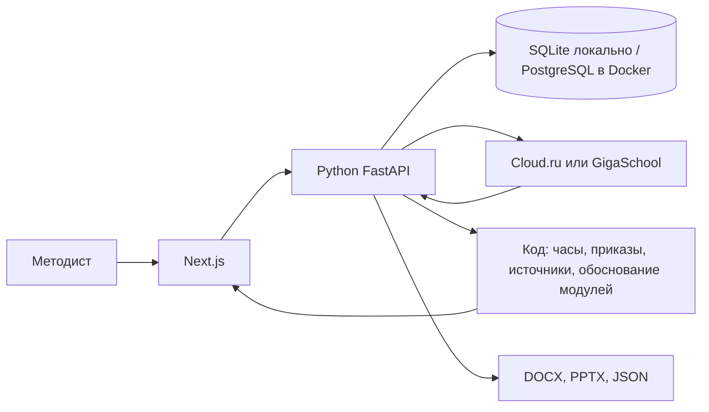
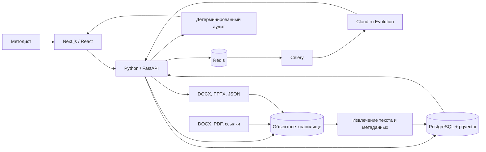

# Архитектура «Студии образовательных программ»

Текущая схема продукта:

В Docker между API и моделью стоят Redis и воркер Celery. Без них ход по-прежнему идёт из API в модель напрямую.

Модель пишет формулировки, когда есть ключ. Код проверяет часы, шаблон, источники и пишет, почему модуль такой. Если ключа нет или шлюз не ответил, пустые места в материалах дописывает код, и чат сообщает об этом явно.

## Планы развития

- **Поиск по загруженным материалам (pgvector).** Только по файлам методиста, не по открытому интернету.
- **Объектное хранилище.** Исходные DOCX/PDF и готовые выгрузки — файлами; в базе ссылка и контрольная сумма.

## Целевая схема (после доработок выше)

## Роли компонентов

- **Next.js / React** — рабочее место методиста: запрос, просмотр программы, ручное утверждение, отчёт и выгрузки.
- **Python / FastAPI** — основной backend: оркестрация шагов и tool calls Cloud.ru, обработка документов, управление версиями курса и API аудита.
- **Redis** — очередь ходов к шлюзу. В Docker это сервис `redis`. Без `REDIS_URL` очереди нет, и ход выполняет сам API.
- **Celery** — воркер `worker` забирает ход и ограничивает, сколько запросов одновременно уходит к модели. Бюджет токенов один на очередь. Число одновременных запросов задаёт `GATEWAY_CONCURRENCY`, по умолчанию 2.
- **Cloud.ru Evolution** — предлагает структурированные изменения разделов, но не утверждает программу и нормативные источники.
- **PostgreSQL** — курсы, разделы, версии, связи результатов обучения с оценочными средствами, метаданные источников и журнал изменений.
- **pgvector** — поиск только по загруженным и подтверждённым материалам. Это не источник юридической истины.
- **Объектное хранилище** — исходные DOCX/PDF и сформированные DOCX/PPTX; в PostgreSQL хранятся ссылки, контрольные суммы и метаданные.
- **Детерминированный аудит** — проверяет часы, обязательные разделы, связи, два средства оценки на результат и наличие источников без участия модели.

## Поток обработки

1. Методист создаёт запрос и прикладывает документы или проверяемые ссылки.
2. Python сохраняет файл в объектное хранилище, а его метаданные — в PostgreSQL.
3. Извлечённый текст индексируется для поиска; номер, дата и применимость нормативного документа не считаются подтверждёнными автоматически.
4. Если Redis запущен и воркер присылает пульс, API кладёт ход в очередь и сразу отдаёт номер. Воркер Celery вызывает модель. Иначе ход выполняет сам API. Часы и источники в обоих случаях проверяет код.
5. Обычный код проверяет часы, полноту и связи.
6. Методист просматривает источники и утверждает каркас.
7. Версия программы и журнал решения сохраняются; DOCX, PPTX и JSON-отчёт формируются по запросу.

## Текущий статус

Работают интерфейс, приём файлов, скелет программы, учебные материалы, аудит, выгрузки, `/api/run` и версионирование курсов через SQLAlchemy. На сервере — PostgreSQL (локально для разработки можно SQLite). Чат идёт в Python. Если backend недоступен, список курсов остаётся в браузере. Исходные и готовые файлы методист скачивает; текст страницы источника в студию не сохраняется; запрос набирается текстом.

Очередь к шлюзу есть в Docker: Redis принимает ход, воркер Celery его выполняет. Одновременно к Cloud.ru или GigaSchool уходит не больше `GATEWAY_CONCURRENCY` запросов, бюджет токенов общий. Пока ход ждёт, чат показывает место в очереди. Кнопка остановки снимает ход. Повтор 429 и 5xx остаётся внутри вызова модели в воркере. Если воркер не дописал комплект, пустые места по-прежнему дописывает код. Без Redis или без пульса воркера ход идёт в процессе API, как раньше.

Голос: кнопка «Голос» пишет не дольше 25 секунд и кладёт текст в поле запроса. Методист может поправить его перед отправкой. Звук разбирает локальная [GigaAM](https://github.com/salute-developers/GigaAM), модель `v3_e2e_rnnt`. Это не шлюз чата и не ключ Cloud.ru. Запись в студию не сохраняется. Часы и источники по-прежнему проверяет код. Векторный поиск и объектное хранилище остаются в планах.

## Правила работы с документами

- Используются материалы Минпросвещения России, Минобрнауки России, Минтруда России, 273-ФЗ, профстандарты и шаблоны АЦР.
- Номер, дата, название приказа и код трудовой функции берутся только из файла или проверяемой ссылки.
- Для каждого источника сохраняются происхождение, реквизиты, дата загрузки и статус проверки.
- Неподтверждённый документ не переносится в итоговую программу как действующий.
- Окончательное решение о применимости документа принимает методист.
