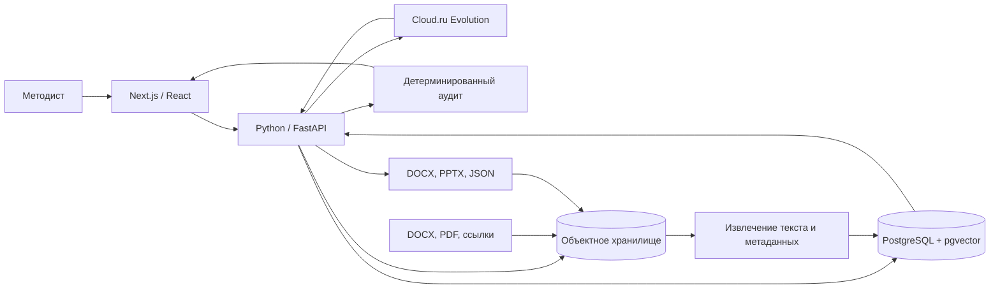

# Архитектура «Студии образовательных программ»

## Целевая схема

## Роли компонентов

- **Next.js / React** — рабочее место методиста: запрос, просмотр программы, ручное утверждение, отчёт и выгрузки.
- **Python / FastAPI** — основной backend: оркестрация шагов, обработка документов, управление версиями курса, API аудита и экспорта.
- **Cloud.ru Evolution** — предлагает структурированные изменения разделов, но не утверждает программу и нормативные источники.
- **PostgreSQL** — курсы, разделы, версии, связи результатов обучения с оценочными средствами, метаданные источников и журнал изменений.
- **pgvector** — поиск только по загруженным и подтверждённым материалам. Это не источник юридической истины.
- **Объектное хранилище** — исходные DOCX/PDF и сформированные DOCX/PPTX; в PostgreSQL хранятся ссылки, контрольные суммы и метаданные.
- **Детерминированный аудит** — проверяет часы, обязательные разделы, связи, два средства оценки на результат и наличие источников без участия модели.

## Поток обработки

1. Методист создаёт запрос и прикладывает документы или проверяемые ссылки.
2. Python сохраняет файл в объектное хранилище, а его метаданные — в PostgreSQL.
3. Извлечённый текст индексируется для поиска; номер, дата и применимость нормативного документа не считаются подтверждёнными автоматически.
4. Оркестратор передаёт модели только нужный контекст и получает структурированное изменение конкретного раздела.
5. Обычный код проверяет часы, полноту и связи.
6. Методист просматривает источники и утверждает каркас.
7. Версия программы и журнал решения сохраняются; DOCX, PPTX и JSON-отчёт формируются по запросу.

## Статус на чекпоинт

Уже работают интерфейс, локальная модель данных, офлайн-пример, аудит, выгрузки и Python API проверки курса и источников. Чат временно использует существующий TypeScript-маршрут.

После получения доступа к Cloud.ru оркестратор переносится в Python и прогоняется на пяти запросах кейса. PostgreSQL, pgvector и объектное хранилище — целевая инфраструктура следующего этапа; сейчас данные курса сохраняются в `localStorage`, поэтому эта часть не заявляется как готовая.

## Правила работы с документами

- Используются материалы Минпросвещения России, Минобрнауки России, Минтруда России, 273-ФЗ, профстандарты и шаблоны АЦР.
- Номер, дата, название приказа и код трудовой функции берутся только из файла или проверяемой ссылки.
- Для каждого источника сохраняются происхождение, реквизиты, дата загрузки и статус проверки.
- Неподтверждённый документ не переносится в итоговую программу как действующий.
- Окончательное решение о применимости документа принимает методист.
